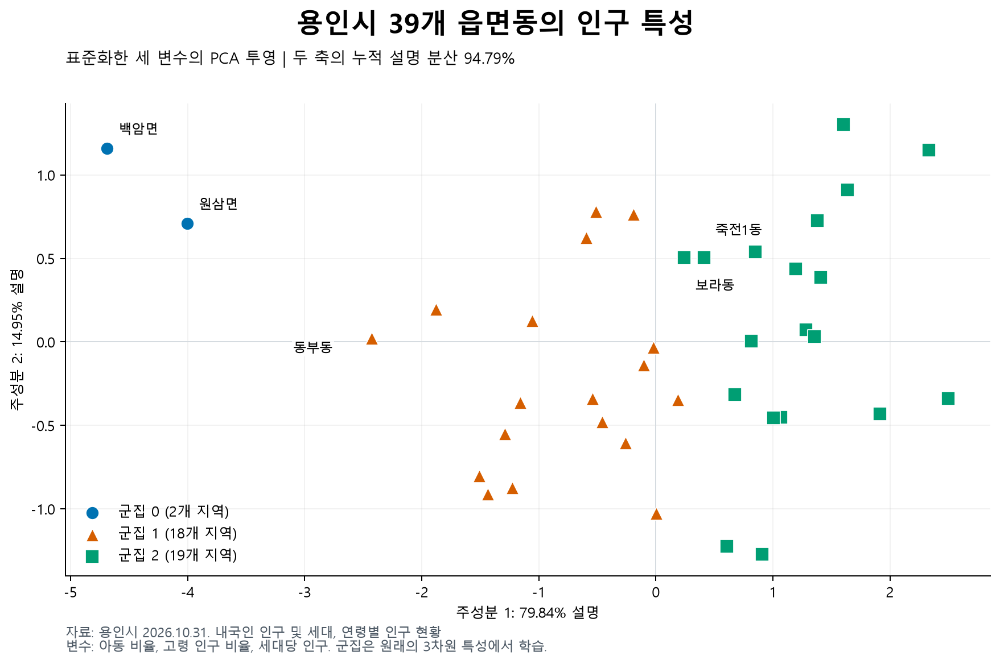
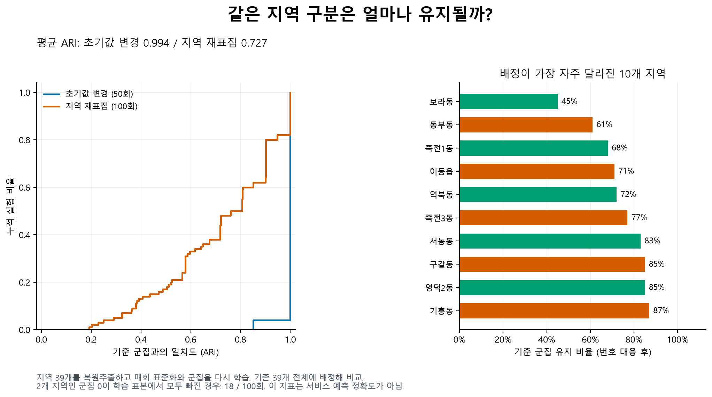

# PCA 및 군집 안정성 검증

동일한 용인시 공식 2026년 10월 말 39개 읍면동 자료와 기존 k=3 모델을 분석했다. [validation.json](validation.json)에 주성분, 좌표, 모든 실행의 ARI, 지역별 배정 유지 비율 및 원본 출처를 저장했다. 운영 기능에는 연결하지 않았다.

## 지역 차이 시각화



세 특성을 표준화하고 공분산 행렬의 고유벡터를 Jacobi 회전으로 직접 계산했다. 첫 주성분은 분산의 79.84%, 둘째는 14.95%를 설명한다. 두 축은 합계 94.79%를 담는다. 원래 3차원에서 학습한 군집 배정을 이 평면에 표시했다. 분석 좌표는 지리 좌표나 수요 점수가 아니다.

고유벡터의 단위 길이, 서로 직교하는 성질, 공분산 행렬과 고유값의 관계를 검사했다. 별도의 NumPy 고유값 계산과도 대조했다. 그림은 로컬 Matplotlib 3.11.2로 PNG 및 SVG를 만들었다.

## 초기값과 표본 변경 검증



| 실험 | 반복 수 | 평균 ARI | 최솟값 | 중앙값 |
| --- | --- | --- | --- | --- |
| 초기값 seed 0~49, 기존 10회 재시작 설정 유지 | 50 | 0.994049 | 0.851218 | 1.000000 |
| 지역 복원추출, 표준화와 군집 재학습 | 100 | 0.727066 | 0.191942 | 0.783297 |

1. ARI(Adjusted Rand Index)는 군집 번호가 달라도 같은 지역들이 함께 묶였는지를 비교한다. 1이면 동일한 분할이며 0은 무작위 일치 보정 기준이다. 음수도 가능하다. 분류 정확도가 아니다.
2. 초기값 실험은 seed만 바꾸고 K-means++의 10회 초기화 중 최소 inertia 선택 설정은 유지했다. 단일 초기화 자체가 항상 안정적이라는 의미는 아니다.
3. 재표집은 seed 20261115로 39개 지역을 복원추출했다. 매번 표본에서 평균과 표준편차 및 군집 중심을 새로 구하고, 원래의 39개 지역 전체를 해당 모델에 배정해 기존 분할과 비교했다. 100회 모두 학습이 완료됐다.
4. 백암면과 원삼면 두 지역인 군집 0이 표본에서 모두 빠진 경우가 18회 있었다. 작은 군집과 경계에 있는 지역 때문에 표본 변화에 민감할 수 있다. 보라동의 기준 군집 유지 비율은 45%, 동부동은 61%, 죽전1동은 68%였다.
5. 지역별 유지 비율은 실행마다 전체 지역의 일치를 가장 크게 하는 군집 번호 대응을 구한 뒤 집계했다. 큰 군집은 전체 일치율을 높게 만들 수 있으므로 ARI와 함께 해석한다.
6. 재표집 ARI의 2.5백분위수는 0.238186, 97.5백분위수는 1.0이다. 이 범위는 해당 시뮬레이션 결과의 분포이며 서비스 성능의 신뢰구간이 아니다.

초기값에 대한 재현성은 높지만 표본 변화에 대한 안정성이 완벽하지는 않다. 한 시점의 39개 집계 지역만 사용했으므로 다른 월의 인구 구조나 실제 서비스 이용 결과까지 일반화할 수 없다.

## 재현

분석 자체는 Python 표준 라이브러리만 사용한다. 그림을 다시 만들 때만 로컬 Matplotlib와 한국어 글꼴이 필요하다.

```powershell
python experiments/offline_ai/cluster_validation.py experiments/offline_ai/results/yongin-2026-10/regions.csv experiments/offline_ai/results/yongin-2026-10/model.json build/reports/yongin-validation.json
python -m pip install -r experiments/offline_ai/requirements-plots.txt
python experiments/offline_ai/plot_cluster_validation.py build/reports/yongin-validation.json build/reports/yongin-figures
```

Windows에서는 맑은 고딕을 사용한다. 다른 환경에서는 설치된 한국어 글꼴을 탐색하거나 `--font-file`에 글꼴 경로를 지정한다. 글꼴이 없으면 깨진 그림을 저장하는 대신 오류를 반환한다. 그림을 위한 패키지를 서버 이미지에 추가하지 않는다.

현재 설명 가능한 범위는 실제 공공데이터를 사용한 PCA 시각화, 초기값 민감도 및 재표집 기반 군집 안정성 분석이다. 서비스 수요 예측이나 고객 행동 검증은 수행하지 않았다.
